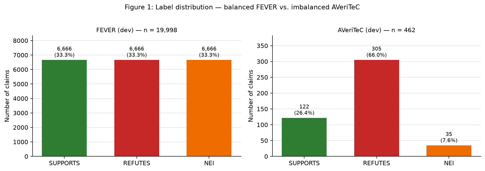
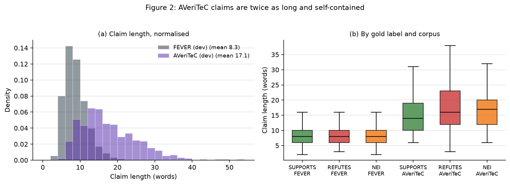
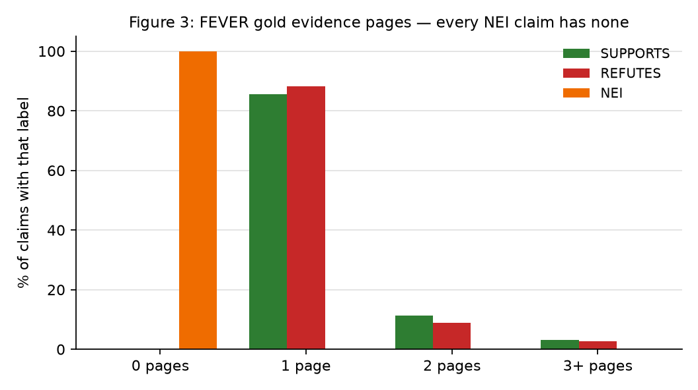
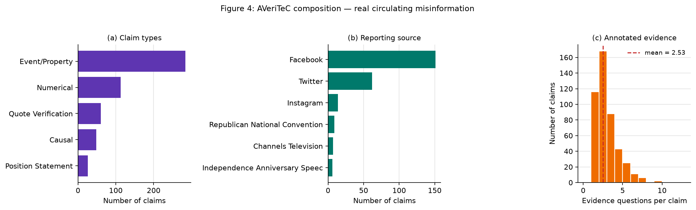

# A Multi-Agent Retrieval-Grounded Architecture for Automated Claim Verification

### With a Calibration-Aware Benchmark Against a Monolithic LLM Baseline

---

## 1. Abstract

Large language models (LLMs) asked to verify a factual claim answer from parametric
memory. Such a model cannot distinguish *"I recall this"* from *"this is documented"*,
and consequently fails hardest precisely where verification matters most: on claims that
changed after the training cutoff, on details it has half-memorised, and on popular
misconceptions that were abundant in its pre-training corpus. Critically, these failures
are not accompanied by reduced confidence.

This work presents a **three-agent retrieval-grounded verification pipeline** that
decomposes claim verification into *evidence acquisition*, *per-snippet natural language
inference*, and *verdict synthesis*, executed by three narrowly-scoped agents under
strict schema contracts. Each agent is constrained so that a specific failure mode is
made structurally impossible rather than merely discouraged by prompt wording.

The system is evaluated against a **monolithic single-LLM control** that receives the
identical claim and emits the identical output schema, differing only in that it has no
access to retrieval. Evaluation is performed on the FEVER dataset [1] and reports not
only accuracy and macro-F1 but also **calibration** — Expected Calibration Error and
Brier score — on the argument that accuracy alone cannot express the central claim of
this work: two systems with equal accuracy are not equivalent if one of them asserts 95%
confidence while being wrong.

---

## 2. What Has Been Implemented

The deliverable is a complete, running system rather than a design document. The
following components are implemented, tested, and verified end-to-end.

| # | Component | Module | Status |
|---|---|---|---|
| 1 | Agent 1 — Evidence Scout | `fact_checker/agents/scout.py` | Implemented, verified live |
| 2 | Agent 2 — Alignment Auditor | `fact_checker/agents/auditor.py` | Implemented, verified live |
| 3 | Agent 3 — Synthesis Adjudicator | `fact_checker/agents/adjudicator.py` | Implemented, verified live |
| 4 | Monolithic baseline control | `fact_checker/agents/baseline.py` | Implemented, verified live |
| 5 | Schema contracts (Pydantic v2) | `fact_checker/schemas.py` | 5 models, validated at every boundary |
| 6 | Retrieval with backoff + dedup | `fact_checker/search.py` | Implemented, degrades gracefully |
| 7 | Pluggable model backend | `fact_checker/llm.py` | Local (Ollama) and hosted (Claude API) |
| 8 | FEVER loader + stratified sampler | `fact_checker/datasets/fever.py` | 19,998 dev claims loaded |
| 9 | Metrics: accuracy, macro-F1, ECE, Brier | `fact_checker/metrics.py` | Stdlib only, unit-pinned |
| 10 | Benchmark harness | `evaluate.py` | Threaded, resumable, cost-gated |
| 11 | Interactive dashboard | `app.py` | Streamlit, side-by-side comparison |
| 12 | Dataset analysis | `analysis/dataset_stats.py` | Produces Tables 3–5 and Figures 1–3 |
| 13 | Test suite | `tests/` | **113 tests, fully offline** |

**Verification status.** The full pipeline has been executed end-to-end on live web
retrieval with local inference (Ollama, `qwen2.5:3b`), completing in approximately 20–27
seconds per claim. The FEVER harness has been executed and produces measured metrics. All
dataset statistics and figures in Section 7 are computed from the cached corpus and are
reproducible via `python analysis/dataset_stats.py`. No figure in this report contains
synthetic or illustrative data.

**Scope limitation stated explicitly.** A large-scale benchmark run (n ≥ 300) has not
been performed. Section 7.4 reports corpus statistics and Section 6.6 defines the
evaluation protocol; headline accuracy figures over a statistically meaningful sample
remain future work, and no such figures are asserted here.

---

## 3. Problem Statement

### 3.1 Formal statement

Let `c` be a natural-language claim and let `Y = {SUPPORTS, REFUTES, NOT_ENOUGH_INFO}`
be a closed label set. Automated fact verification requires a function

```
    f : c  ↦  (y, κ, C)        where  y ∈ Y,  κ ∈ [0,1],  C ⊆ E
```

that returns a verdict `y`, a **calibrated** confidence `κ`, and a set `C` of citations
drawn from an evidence pool `E`. Calibration requires that `κ` behave as a probability:

```
    P( y = y*  |  κ = p )  =  p       for all p ∈ [0,1]
```

where `y*` is the gold label. A system satisfying the accuracy objective but violating
the calibration objective is unsafe for deployment, because a downstream consumer cannot
distinguish a reliable verdict from an unreliable one.

### 3.2 Why the monolithic formulation fails

The dominant contemporary approach implements `f` as a single LLM call, so that
`f(c) = LLM(c)`. This induces three structural defects:

**(P1) Unverifiable provenance.** The model conditions on parameters `θ` encoding
training data, so it computes `p(y | c; θ)` rather than `p(y | c, E)`. The citation set
`C` cannot be grounded — any citation produced is generated text, not a reference to a
retrieved document. Hallucinated citations are therefore not an anomaly but the expected
behaviour of the formulation.

**(P2) Temporal staleness.** `θ` is fixed at training time. For any claim whose truth
value changed after the cutoff, the model's most confident answer is systematically the
stale one. The failure is silent.

**(P3) Confidence–accuracy decoupling.** `κ` is produced by the same forward pass that
produces `y`. There is no independent signal against which confidence can be
calibrated, so `κ` tends to reflect fluency and training-data frequency rather than
evidential support. Popular misconceptions — abundant in pre-training data — are
therefore asserted *confidently*.

### 3.3 Secondary problems introduced by decomposition

Decomposing `f` into cooperating agents addresses P1–P3 but introduces its own failure
modes, which any honest treatment must also solve:

**(P4) Confirmation bias in retrieval.** An agent that both formulates queries and knows
the claim will tend to formulate queries that confirm it, biasing `E` before inference
begins.

**(P5) Memory leakage across the closed-world boundary.** An inference agent instructed
to judge a snippet may silently substitute its own parametric knowledge, reintroducing
P1 through the back door while appearing grounded.

**(P6) Aggregation by volume rather than by probative weight.** Naive majority voting
over per-snippet labels lets `k` weak, tangential documents outweigh one decisive one —
particularly damaging when syndicated copies of a single source masquerade as
independent corroboration.

### 3.4 Research questions

- **RQ1.** Does architectural decomposition into scoped agents with enforced schema
  contracts improve verdict accuracy over a monolithic LLM given the same claim?
- **RQ2.** Does retrieval grounding improve **calibration** (ECE, Brier), independently
  of any improvement in accuracy?
- **RQ3.** Can the secondary failures P4–P6 be suppressed by *architectural* constraints
  — validated schemas and deterministic reconciliation — rather than by prompt wording
  alone?

---

## 4. Introduction

### 4.1 Motivation

The economics of producing text have inverted. Generating a fluent, confident, false
assertion is now effectively free, while verifying one remains expensive and largely
manual. Vlachos and Riedel [2] first framed fact-checking as a computational task
amenable to NLP, and the subsequent decade has seen it become a central application
area, surveyed comprehensively by Guo et al. [3] and Thorne and Vlachos [4].

Modern LLMs are attractive candidates for this task: they are fluent, broadly
knowledgeable, and require no task-specific training. Yet Ji et al. [5] document that
hallucination — fluent, confident, unfounded generation — is intrinsic rather than
incidental to the paradigm. Petroni et al. [6] showed that LLMs do encode substantial
relational knowledge, which is precisely what makes the failure mode dangerous: the
model is *often* right, so its confidence is *usually* warranted, and a user cannot tell
which case they are in.

### 4.2 From parametric to retrieved knowledge

The standard remedy is to condition generation on retrieved documents. Lewis et al. [7]
formalised Retrieval-Augmented Generation (RAG), and Guu et al. [8] showed with REALM
that retrieval can be integrated into pre-training. Both demonstrate that grounding
improves factual accuracy on knowledge-intensive tasks.

However, RAG as ordinarily deployed remains a *single* generation step conditioned on
concatenated documents. This leaves three of the defects in Section 3 unresolved. A
single pass provides no mechanism to prevent the model from mixing retrieved evidence
with parametric memory (P5); it provides no audit trail establishing *which* document
drove *which* part of the verdict (P1); and it gives no principled basis for weighing
contradictory documents (P6). Empirically, retrieval-augmented systems still produce
citations that do not support their claims — the phenomenon Kamoi et al. [9] study as
sub-sentence entailment and Min et al. [10] operationalise as atomic-fact precision in
FActScore.

### 4.3 From single-pass to decomposed reasoning

A parallel line of work decomposes reasoning into explicit steps. Wei et al. [11] showed
chain-of-thought prompting elicits intermediate reasoning; Yao et al. [12] interleaved
reasoning with tool use in ReAct; Khattab et al. [13] composed retrieval and generation
into multi-step programs; and Trivedi et al. [14] interleaved retrieval with
chain-of-thought for multi-step questions. Du et al. [15] showed that multiple model
instances debating a question improve factuality over a single instance.

The insight this work builds on is that **decomposition is valuable primarily because it
permits constraint**. A monolithic prompt instructing a model to "use only the provided
evidence" is unenforceable — there is no boundary at which the instruction can be
checked. When the same task is split across agents communicating through validated
schemas, each boundary becomes a point at which violations are *detectable and
correctable in code*.

### 4.4 The neglected axis: calibration

Accuracy is the near-universal reporting metric for fact verification, yet it is
insufficient for the deployment question. Guo et al. [16] demonstrated that modern
neural networks are systematically overconfident, and introduced Expected Calibration
Error following the binning approach of Naeini et al. [17], building on the much older
proper scoring rule of Brier [18]. For LLMs specifically, Kadavath et al. [19] found
models possess partial self-knowledge of correctness, while Lin et al. [20] and Xiong et
al. [21] found *verbalised* confidence to be poorly calibrated and persistently
overconfident.

This matters directly: a fact-checker that is 70% accurate and knows it is far more
useful than one that is 75% accurate and claims 95%. The first can be deferred to a human
on low-confidence cases; the second cannot. This work therefore treats calibration as a
first-class objective and reports it alongside accuracy throughout.

### 4.5 Contributions

1. A three-agent verification architecture in which each agent's scope is narrowed so
   that a specific failure mode (P4, P5, P6) is structurally suppressed (Section 6.2–6.4).
2. A set of **deterministic post-conditions** — audit reconciliation and citation
   validation — that repair or reject malformed agent output in code rather than trusting
   prompt compliance (Section 6.5, Algorithms 2 and 3).
3. A controlled benchmark design in which the grounded and ungrounded systems emit an
   identical output schema, making the comparison exactly 1:1 (Section 6.6).
4. A calibration-aware evaluation protocol reporting ECE, Brier score, and the
   overconfidence gap alongside classification metrics (Section 6.7).
5. An open, reproducible implementation running on either local or hosted inference, with
   113 offline tests and scripted dataset analysis.

---

## 5. Related Work

**Thorne et al. [1]** introduced FEVER, the benchmark that defined the modern task
formulation: 185,445 claims generated by mutating Wikipedia sentences, each labelled
`SUPPORTED`, `REFUTED`, or `NOTENOUGHINFO`, with annotated sentence-level evidence. Its
three-way label set is adopted directly by this work. The accompanying shared task
established the standard pipeline — document retrieval, sentence selection, then textual
entailment — which remains the dominant decomposition.

**Hanselowski et al. [22]** (UKP-Athene) and **Nie et al. [23]** produced the strongest
early FEVER systems, both retaining the three-stage pipeline while improving each stage
independently. Nie et al. [23] in particular showed that a neural semantic matching
network applied uniformly across all three stages outperformed stage-specific
architectures, an early indication that the *decomposition* carries more benefit than any
individual component.

**Zhou et al. [24]** (GEAR) and **Liu et al. [25]** (KGAT) advanced evidence
*aggregation* specifically, modelling the evidence set as a graph and propagating
information between sentences rather than scoring each in isolation. Their finding that
inter-evidence reasoning improves verdicts motivates the separation, in this work, of
per-snippet inference (Agent 2) from cross-snippet synthesis (Agent 3).

**Soleimani et al. [26]** applied BERT [27] to both retrieval and verification stages,
establishing transformer entailment as the standard component. The entailment
formulation itself descends from the natural language inference datasets of **Bowman et
al. [28]** (SNLI) and **Williams et al. [29]** (MultiNLI), whose three-way
entailment / contradiction / neutral scheme maps directly onto FEVER's labels and onto
Agent 2's per-snippet task in this work.

**Schuster et al. [30]** (VitaminC) exposed a critical weakness: FEVER-trained models
rely on claim-only artefacts rather than genuine evidence comparison, and are brittle
when evidence changes. Their contrastive construction directly motivates this work's
**closed-world constraint** on Agent 2 — the requirement that a justification quote the
snippet's exact tokens is an enforcement mechanism against precisely this
artefact-exploitation.

**Aly et al. [31]** (FEVEROUS) extended verification to structured tables, and
**Schlichtkrull et al. [32]** (AVeriTeC) moved to real-world claims with open-web
evidence and explicit question-answer decomposition. AVeriTeC is especially relevant
here: it acknowledges that a fixed Wikipedia snapshot is an artificial evidence
condition, the same concern this work raises in Section 7.5.

**Lewis et al. [7]** and **Guu et al. [8]** established retrieval-augmented generation
and retrieval-augmented pre-training respectively, providing the general mechanism by
which this work grounds verdicts. **Khattab et al. [13]**, **Yao et al. [12]**, and
**Trivedi et al. [14]** extended single-step retrieval into multi-step,
reasoning-interleaved programs, the paradigm this work's pipeline instantiates.

**Du et al. [15]** showed multi-agent debate improves factuality, and **Wang et al. [33]**
showed self-consistency sampling improves reasoning reliability. Both demonstrate that
*multiple constrained passes* outperform one unconstrained pass — the premise underlying
this architecture — though both aggregate over homogeneous agents, whereas this work
assigns each agent a distinct, narrower role.

**Min et al. [10]** (FActScore) and **Chern et al. [34]** (FacTool) applied verification
to LLM-generated text, decomposing outputs into atomic facts checked independently.
Their atomic decomposition parallels this work's per-snippet independence assumption
(Equation 3). **Kamoi et al. [9]** (WiCE) showed that real-world entailment is frequently
partial, motivating the explicit handling of partially-supporting evidence in Agent 3's
weighting rules.

On calibration, **Guo et al. [16]** established systematic overconfidence in modern
networks and popularised ECE, refining the binning estimator of **Naeini et al. [17]**
over the proper scoring rule of **Brier [18]**. For language models, **Kadavath et al.
[19]** found partial self-knowledge of correctness, while **Lin et al. [20]** and
**Xiong et al. [21]** found verbalised confidence persistently overconfident. **Ji et al.
[5]** and **Guo et al. [3]** provide the surveys situating hallucination and automated
fact-checking respectively.

### 5.1 Summary

The literature converges on three findings that jointly motivate this work. First,
**decomposition outperforms monolithic processing** for verification: from the original
FEVER pipeline [1, 22, 23] through graph-based aggregation [24, 25] to multi-step
LLM programs [12, 13, 14] and multi-agent debate [15], separating retrieval from
inference from aggregation consistently improves results. Second, **grounding alone is
insufficient** — VitaminC [30] showed models exploit claim-only artefacts even when
evidence is supplied, and WiCE [9] and FActScore [10] showed cited evidence frequently
fails to entail the claim it is attached to; grounding must therefore be *enforced*, not
merely afforded. Third, **calibration is measured far less often than accuracy** [16, 19,
20, 21] despite being the property that determines whether a verdict can be safely acted
upon.

The gap this work addresses is the conjunction of these three. Existing systems
decompose, or ground, or (rarely) calibrate — but the enforcement mechanisms that make
decomposition *reliable* are typically left to prompt wording, and the resulting
confidence scores are typically left unmeasured. This work supplies deterministic
post-conditions at each agent boundary and evaluates the outcome on both accuracy and
calibration axes against a schema-identical ungrounded control.

---

## 6. Methodology

### 6.1 Task formalisation and the factorisation

The monolithic formulation estimates the verdict directly from parameters:

> **(1)**  `ŷ_base = arg max_{y ∈ Y}  p(y | c ; θ)`

This is the control system (Section 6.6). The proposed system instead introduces an
explicit evidence variable `E` and factorises the posterior:

> **(2)**  `p(y | c) = Σ_E  p(y | c, E) · p(E | c)`

where `p(E | c)` is realised by Agent 1 (query generation and retrieval) and `p(y | c, E)`
by Agents 2 and 3. The central modelling decision is how `p(y | c, E)` is computed. Rather
than a single pass over the concatenated evidence, it is decomposed under a **conditional
independence assumption** over snippets:

> **(3)**  `p(y | c, E) = A( { g(c, e_i) }_{i=1..n} )`
>
> where `g(c, e_i) → ℓ_i ∈ Y` is per-snippet inference (Agent 2)
> and `A : Y^n → (Y × [0,1])` is the aggregation operator (Agent 3).

Equation 3 is the theoretical core. Each snippet `e_i` is judged **independently**, so
`g(c, e_i)` cannot condition on `e_j` for `j ≠ i`. This is a deliberate modelling
restriction, and it directly targets two of the problems in Section 3:

- It blocks **P6** (aggregation by volume) from contaminating inference, because a
  majority among snippets cannot pull an individual label. Weighing happens once,
  explicitly, in `A`.
- It makes **P5** (memory leakage) *detectable*: since `g` sees only `e_i`, any
  justification referencing information absent from `e_i` is a verifiable violation.

The cost of the assumption is that genuine cross-snippet inference — where two snippets
jointly entail a claim that neither entails alone — is deferred entirely to `A`. This is
the same trade-off GEAR [24] and KGAT [25] resolve differently, by propagating
information *between* evidence sentences. Their approach is more expressive; the approach
here is more auditable, because every intermediate label is attributable to exactly one
source document.

### 6.2 Agent 1 — Evidence Scout

Agent 1 realises `p(E | c)`. It is given one capability and denied another: it generates
queries, and it is **forbidden from judging the claim**. This separation addresses **P4**.

Given claim `c`, it emits queries `Q = {q_1, q_2}` under the constraint that `q_1`
targets the core entity or quantity, while `q_2` approaches the same fact from an
*independent angle* (official record, primary source, or current status). Neither query
may presuppose the truth value of `c`.

> **Algorithm 1 — Evidence acquisition**
> ```
> Input : claim c, results-per-query k, evidence cap m, snippet length L
> Output: query set Q, evidence pool E
>
>  1  Q ← LLM_scout(c)                      ▷ schema-constrained: exactly 2 queries
>  2  if Q = ∅ then Q ← {c}                 ▷ degrade to the raw claim
>  3  E ← ∅ ;  U ← ∅ ;  B ← ∅               ▷ evidence, seen URLs, seen snippet prefixes
>  4  for each q ∈ Q do
>  5      if |E| ≥ m then break
>  6      R ← SEARCH(q, k)                  ▷ with exponential backoff, §6.2.1
>  7      for each r ∈ R do
>  8          if |E| ≥ m then break
>  9          u ← url(r) ;  b ← lower(body(r)[0:120])
> 10          if u ∈ U or b ∈ B then continue        ▷ syndication guard
> 11          U ← U ∪ {u} ;  B ← B ∪ {b}
> 12          e ← ⟨ id: "doc_" ‖ (|E|+1),  text: truncate(body(r), L) ⟩
> 13          E ← E ∪ {e}
> 14  return Q, E
> ```

**6.2.1 Retrieval reliability.** Line 6 retries with delay `d_t = d_0 · 2^t`, doubled
again when the error matches a rate-limit signature. On exhaustion it returns `∅` with a
warning rather than raising, so that `E = ∅` propagates and the system correctly
concludes `NOT_ENOUGH_INFO` instead of failing.

**6.2.2 The syndication guard.** Line 10 deduplicates on **both** URL and the first 120
characters of body text. URL-only deduplication is insufficient: a wire story mirrored
across outlets yields distinct URLs with identical text, which `A` would otherwise read
as independent corroboration — an instance of **P6** entering through retrieval rather
than aggregation.

### 6.3 Agent 2 — Alignment Auditor

Agent 2 implements `g(c, e_i)` from Equation 3: a three-way natural language inference
task in the sense of Bowman et al. [28], with the claim as hypothesis and the snippet as
premise. The mapping between conventions is exact:

| NLI convention [28, 29] | FEVER convention [1] | This work |
|---|---|---|
| Entailment | SUPPORTED | `SUPPORTS` |
| Contradiction | REFUTED | `REFUTES` |
| Neutral | NOTENOUGHINFO | `NOT_ENOUGH_INFO` |

Two constraints are imposed, each targeting a documented failure:

**(C1) Closed-world restriction.** `g` may use only the tokens of `e_i`. If the agent
privately knows `c` is true but `e_i` does not establish it, the required label is
`NOT_ENOUGH_INFO`. This attacks **P5** directly.

**(C2) Extractive justification.** Every label carries a one-sentence justification that
must quote the exact words or numbers from `e_i` that determined it. This is the
enforcement mechanism for C1: a justification that cannot ground itself in the snippet's
tokens is evidence that parametric memory was used. It responds to the artefact
exploitation Schuster et al. [30] identified, by making the evidential basis of each
label externally inspectable.

The prompt additionally encodes three discriminations that are frequent error sources:
partial overlap (confirming an entity exists does not support a claim about its
attributes), near-miss quantities (a snippet stating 1971 *refutes* a claim of 1969 — it
does not merely fail to support it), and superseded state (a past-tense description does
not establish a present-tense claim).

### 6.4 Agent 3 — Synthesis Adjudicator

Agent 3 implements `A` from Equation 3. It receives the audit list — not the raw
snippets — which enforces that synthesis operates on judgements rather than re-deriving
them.

The operator is not majority vote. Let `ℓ_i` be the label and `s_i ∈ {0,1}` indicate
whether justification `i` cites a specific figure, date, or named record. The weighting
policy is:

> **(4)**  `w_i = 1 + β · s_i` ,  β > 0
>
> **(5)**  `score(y) = Σ_{i : ℓ_i = y}  w_i`
>
> **(6)**  `ŷ = arg max_{y ∈ {S,R}} score(y)` if `max score > 0`, else `NOT_ENOUGH_INFO`

Equations 4–6 describe the *policy the agent is instructed to apply*; it is realised
through natural-language reasoning rather than executed arithmetic, with `β` expressed
as the instruction that specific evidence outranks vague evidence. Four adjudication
rules follow from it:

1. **Direct evidence outranks volume** (Equation 4): one decisive snippet beats several
   tangential ones. This is the primary defence against **P6**.
2. **Specificity breaks conflicts:** on genuine `SUPPORTS`/`REFUTES` conflict, the side
   quoting figures, dates, or official records wins, and the reasoning must state what
   was discounted and why.
3. **Absence is not refutation:** if the only signal is `NOT_ENOUGH_INFO`, the verdict is
   `NOT_ENOUGH_INFO`. This asymmetry is essential — the opposite convention would make
   retrieval failure indistinguishable from disconfirmation.
4. **Partial truth is refutation:** a claim correct in substance but wrong in its
   specific assertion (wrong figure, date, or superlative) is `REFUTES`. This follows
   Kamoi et al. [9] on partial entailment.

**Confidence calibration.** `κ` is elicited against an explicit rubric rather than as a
free-form number, following the finding of Lin et al. [20] that unanchored verbalised
confidence is poorly calibrated:

| Range | Evidential condition |
|---|---|
| 0.90 – 1.00 | Multiple independent snippets agree and quote specifics |
| 0.70 – 0.89 | Clear evidence from one strong snippet, or agreement without specifics |
| 0.50 – 0.69 | Evidence leans one way but is indirect, dated, or thin |
| 0.25 – 0.49 | Conflicting or mostly tangential evidence |
| 0.00 – 0.24 | Effectively no usable evidence |

### 6.5 Deterministic post-conditions

Constraints expressed in prompts are *requests*. The following post-conditions are
**enforced in code** at agent boundaries, and constitute contribution 2. They exist
because an LLM that violates a schema still returns syntactically valid output.

> **Algorithm 2 — Audit reconciliation (Agent 2 post-condition)**
> ```
> Input : audit list Λ from Agent 2, expected identifiers D = {doc_1..doc_n}
> Output: reconciled Λ' with |Λ'| = |D|, one entry per identifier
>
>  1  M ← ∅                                     ▷ ordered map: id ↦ alignment
>  2  for each λ ∈ Λ do
>  3      if id(λ) ∈ D and id(λ) ∉ M then
>  4          M[id(λ)] ← λ                      ▷ first judgement wins
>  5      ▷ else: hallucinated or duplicate identifier — discarded
>  6  Λ' ← ∅
>  7  for each d ∈ D in order do
>  8      if d ∈ M then Λ' ← Λ' ‖ M[d]
>  9      else Λ' ← Λ' ‖ ⟨d, NOT_ENOUGH_INFO, "no judgement returned"⟩
> 10  return Λ'
> ```

Algorithm 2 guarantees a bijection between retrieved snippets and audit entries.
Hallucinated identifiers are dropped (line 5); omitted snippets are backfilled as
`NOT_ENOUGH_INFO` (line 9), which is the conservative direction — it can only weaken a
verdict, never manufacture support. Agent 3 therefore always receives a complete audit.

> **Algorithm 3 — Citation validation (Agent 3 post-condition)**
> ```
> Input : adjudication a, valid identifier set D
> Output: adjudication with verified citations
>
>  1  C ← dedup( [ x ∈ cited(a)  :  x ∈ D ] )   ▷ drop fabricated identifiers
>  2  if C = ∅ then
>  3      C ← dedup( [ x ∈ regex("doc_\d+", reasoning(a))  :  x ∈ D ] )
>  4  claim(a) ← c_original                     ▷ pin to the user's exact wording
>  5  return a with cited(a) ← C
> ```

Line 1 discards any citation not corresponding to genuinely retrieved evidence,
addressing **P1**. Line 3 handles an empirically observed failure: smaller models
routinely cite inline in prose (*"[doc_3] states that…"*) while leaving the structured
citation array empty. Recovering these is *repair*, not fabrication — the reference was
genuinely made by the model — and every recovered identifier is still validated against
`D`. Line 4 pins the verdict to the user's exact wording, preventing a paraphrase from
silently changing what was adjudicated.

For the baseline, the citation set is discarded **unconditionally**: having performed no
retrieval, any citation it emits is fabricated by construction.

### 6.6 The control condition

The baseline implements Equation 1. It is given the identical claim, is instructed to
use only internal knowledge, and — critically — emits the **identical output schema** as
Agent 3. The comparison is therefore 1:1 on every field: verdict, confidence, reasoning,
and citations. The single controlled variable is access to retrieved evidence.

### 6.7 Evaluation metrics

Let `N` be the number of evaluated claims, `y*_j` the gold label, `ŷ_j` the prediction,
and `κ_j` the confidence.

**Classification.** Per-label F1 with macro-averaging, which weights all three labels
equally regardless of support:

> **(7)**  `F1_y = 2 · P_y · R_y / (P_y + R_y)`
>
> **(8)**  `macro-F1 = (1/|Y|) · Σ_{y ∈ Y} F1_y`

**Calibration.** Partition predictions into `M = 10` equal-width confidence bins
`B_1..B_M`. Following Naeini et al. [17] and Guo et al. [16]:

> **(9)**  `acc(B_m) = (1/|B_m|) · Σ_{j ∈ B_m} 1[ŷ_j = y*_j]`
>
> **(10)** `conf(B_m) = (1/|B_m|) · Σ_{j ∈ B_m} κ_j`
>
> **(11)** `ECE = Σ_{m=1..M} (|B_m| / N) · | acc(B_m) − conf(B_m) |`

A perfectly calibrated system satisfies `acc(B_m) = conf(B_m)` for all `m`, giving
`ECE = 0`. The Brier score [18], a strictly proper scoring rule over correctness:

> **(12)** `BS = (1/N) · Σ_{j=1..N} ( κ_j − 1[ŷ_j = y*_j] )²`

And the aggregate overconfidence gap, positive when a system claims more certainty than
it earns:

> **(13)** `Δ = (1/N) Σ_j κ_j  −  (1/N) Σ_j 1[ŷ_j = y*_j]`

Equations 11–13 are what make RQ2 answerable. Two systems may tie on Equation 8 while
differing sharply on Equation 11, and it is that difference which determines whether a
verdict can be safely acted upon. Mean confidence is additionally reported partitioned by
correctness: a well-behaved system separates `E[κ | correct]` from `E[κ | incorrect]`,
whereas an ungrounded one does not.

---

## 7. Dataset Description

### 7.1 Selection rationale

**Two corpora are used, for different purposes.** FEVER [1] supplies
*comparability*: it is the canonical benchmark, its three-way label set is identical to
the pipeline's output vocabulary, and a reviewer knows what its numbers mean. AVeriTeC
[32] supplies *validity*: its claims are naturally occurring, its evidence is open-web,
and it post-dates FEVER by five years.

Relying on FEVER alone would be unsound here, for four reasons:

1. **Contamination.** FEVER was published in 2018; its claims and labels have been
   publicly available for years and are plausibly present in the pre-training data of the
   models under evaluation. Because the *control* condition in this work is precisely an
   ungrounded model drawing on parametric memory, the baseline may be partly recalling the
   benchmark rather than reasoning about the world — biasing the exact quantity being
   measured.
2. **Claim-only artefacts.** Schuster et al. [30] showed classifiers score well above
   chance on FEVER with the evidence removed, because the claim-mutation process left
   surface giveaways. An unknown fraction of the benchmark therefore does not test
   evidence use at all.
3. **Corpus-relative NEI.** FEVER's `NOT_ENOUGH_INFO` is defined by absence within a
   fixed 2017 snapshot (§7.5), a definition an open-web system does not implement.
4. **Distribution mismatch.** FEVER claims are short mutated Wikipedia sentences about
   entities; real fact-checking targets political, health, and scientific claims.

AVeriTeC addresses all four. The two are reported separately and are expected to
disagree; that disagreement is itself informative.

**Table 1 — Candidate corpora considered**

| Corpus | Scale | Labels | Evidence source | Selected |
|---|---|---|---|---|
| FEVER [1] | 185,445 claims | 3-way (S / R / NEI) | Wikipedia, June 2017 dump | **Yes** — comparability |
| LIAR [35] | 12,836 statements | 6-way truthfulness | PolitiFact metadata | No — label mismatch |
| VitaminC [30] | 450,000 pairs | 3-way, contrastive | Wikipedia revisions | No — pair-level, not claim-level |
| FEVEROUS [31] | 87,026 claims | 3-way + tables | Wikipedia text + tables | No — requires table reasoning |
| AVeriTeC [32] | 4,568 claims | 4-way | Open web | **Yes** — validity cross-check |

### 7.2 Corpus specification

**Table 2 — FEVER split used**

| Property | Value |
|---|---|
| Split | `shared_task_dev.jsonl` (labelled development set) |
| Source | `https://fever.ai/download/fever/` |
| File size | 4.35 MB |
| Format | JSON Lines, one claim object per line |
| Labelled claims loaded | **19,998** |
| Label vocabulary | `SUPPORTS`, `REFUTES`, `NOT ENOUGH INFO` |
| Evidence corpus | Wikipedia, June 2017 snapshot |
| Retrieval used in this work | **Live open web** (see §7.5) |

Each record carries `id`, `label`, `claim`, `verifiable`, and a nested `evidence`
structure of `[annotation_id, evidence_id, page_title, sentence_id]` tuples. Page titles
are escaped (`-LRB-` / `-RRB-` for parentheses, `_` for spaces) and are unescaped on
load. The label `NOT ENOUGH INFO` is normalised to `NOT_ENOUGH_INFO` to match the
internal schema.

### 7.3 Label distribution

**Table 3 — Label distribution and per-label statistics** (computed, n = 19,998)

| Gold label | Count | Share | Mean claim length (words) | Median | SD | Mean gold pages |
|---|---:|---:|---:|---:|---:|---:|
| `SUPPORTS` | 6,666 | 33.33% | 8.27 | 8 | 3.24 | 1.21 |
| `REFUTES` | 6,666 | 33.33% | 8.32 | 8 | 2.89 | 1.19 |
| `NOT_ENOUGH_INFO` | 6,666 | 33.33% | 8.41 | 8 | 3.31 | **0.00** |
| **Total** | **19,998** | **100%** | **8.33** | **8** | **3.17** | 0.80 |

The dev split is **exactly balanced** — 6,666 claims per label by construction. This is a
favourable property: accuracy is directly interpretable against a 33.3% random baseline,
and no class reweighting is required. The stratified sampler is consequently a no-op at
full size; it is retained because small subsamples drawn without stratification fluctuate
enough to skew accuracy by chance, and because other splits carry no such guarantee.



*Figure 1 — Label distribution. FEVER is balanced by construction; AVeriTeC
reflects what fact-checkers actually publish on.*

### 7.4 Claim characteristics

**Table 4 — Claim length statistics** (words, whitespace-tokenised)

| Statistic | Value |
|---|---:|
| Mean | 8.3 words |
| Median | 8 words |
| Standard deviation | 3.2 words |
| Minimum | 2 words |
| Maximum | 36 words |
| Mean characters | 48.9 |



*Figure 2 — (a) Normalised claim-length density, both corpora; (b) length by gold
label and corpus. AVeriTeC claims are roughly twice as long.*

Two properties are consequential for system design. First, claims are **short** — a
median of 8 words — and drawn from mutated Wikipedia sentences, so they are frequently
*decontextualised* (e.g. *"Tilda Swinton is a vegan."*). Referents are often ambiguous
without the source article, which stresses Agent 1's query formulation far more than a
naturally-occurring claim would.

Second, length is **near-identical across labels** (8.3 / 8.3 / 8.4 words, overlapping
interquartile ranges in Figure 2b). This is methodologically important: it means claim
length carries essentially no signal about the gold label, so a system cannot exploit
surface length as a shortcut. This is the desirable counterpart to the claim-only
artefacts Schuster et al. [30] identified on other axes.

### 7.5 Evidence annotation and the corpus-mismatch caveat

**Table 5 — Gold evidence-page annotations by label**

| Gold label | Claims with 0 pages | 1 page | 2 pages | 3+ pages | Mean |
|---|---:|---:|---:|---:|---:|
| `SUPPORTS` | 0.0% | 85.6% | 11.3% | 3.2% | 1.21 |
| `REFUTES` | 0.0% | 88.3% | 9.0% | 2.8% | 1.19 |
| `NOT_ENOUGH_INFO` | **100.0%** | 0.0% | 0.0% | 0.0% | 0.00 |

Of the 19,998 claims, 13,332 are flagged `VERIFIABLE` and 6,666 `NOT VERIFIABLE` —
exactly the `NOT_ENOUGH_INFO` partition.



*Figure 3 — FEVER gold Wikipedia pages per claim, by label. Every NEI claim has none.*

Table 5 and Figure 3 make a limitation precise and unavoidable, and it must be stated
plainly because it conditions every metric reported against this corpus:

> **FEVER's `NOT_ENOUGH_INFO` label means "unverifiable from the June 2017 Wikipedia
> snapshot", not "unverifiable in principle."** Every NEI claim has *zero* annotated
> evidence pages — the label is defined by absence within a fixed corpus.

This system retrieves from the **live open web**. A claim FEVER marks NEI because its
2017 Wikipedia snapshot was silent may be straightforwardly verifiable today. The
pipeline may therefore return `SUPPORTS` — and be **correct about the world** — while
scoring as an error. Three consequences follow:

1. NEI recall is expected to be **systematically depressed**, and this is a property of
   the evaluation design rather than a defect of the system.
2. Results constitute *"FEVER-labelled claims under open-web retrieval"*, **not** official
   FEVER scoring. The official metric additionally requires retrieving the gold Wikipedia
   sentences, which this pipeline never observes.
3. The comparison the design **does** support cleanly is the controlled one: the grounded
   and ungrounded systems face identical claims under identical conditions, so the
   *difference* between them remains valid even where the absolute numbers are depressed.

This caveat is printed by the harness with every report, so that no figure can circulate
detached from it. AVeriTeC [32] was constructed partly in response to this same concern.

### 7.6 AVeriTeC — the validity cross-check

**Table 6 — AVeriTeC dev split** (computed, `dev.json`, 1.8 MB)

| Property | Value |
|---|---|
| Source | `https://raw.githubusercontent.com/MichSchli/AVeriTeC/main/data/` |
| Records in split | 500 |
| Usable after label mapping | **462** |
| Excluded (`Conflicting Evidence/Cherrypicking`) | 38 |
| Claim year | 2020 (all 462) |
| Evidence | Open-web QA pairs (mean 2.53 questions, 2.74 answers per claim) |

**Table 7 — Label distribution, AVeriTeC vs. FEVER**

| Label | AVeriTeC | Share | FEVER | Share |
|---|---:|---:|---:|---:|
| `SUPPORTS` | 122 | 26.4% | 6,666 | 33.3% |
| `REFUTES` | 305 | 66.0% | 6,666 | 33.3% |
| `NOT_ENOUGH_INFO` | 35 | 7.6% | 6,666 | 33.3% |

AVeriTeC is heavily **imbalanced** — two thirds of its claims are `REFUTES`, reflecting
that fact-checking organisations publish mostly on claims they intend to debunk. With
only 35 NEI claims, a label-balanced sample is capped at 35 per class (105 claims). This
is the price of ecological validity, and it is the opposite trade-off to FEVER's
synthetic balance.



*Figure 4 — AVeriTeC composition: (a) claim types, (b) reporting source, (c) annotated
evidence questions per claim.*

**Table 8 — Claim characteristics compared**

| Property | AVeriTeC | FEVER |
|---|---:|---:|
| Mean claim length | **17.1 words** | 8.3 words |
| Median | 15.5 | 8 |
| Standard deviation | 7.7 | 3.2 |
| Range | 3–53 words | 2–36 words |
| Mean characters | 104.3 | 48.9 |

AVeriTeC claims are **more than twice as long** and carry their own context, where FEVER
claims are decontextualised sentence fragments. The provenance differs just as sharply:
AVeriTeC's top reporting sources are Facebook (151), Twitter (62), and Instagram (14) —
i.e. actual circulating misinformation — and its claim types are `Event/Property` (284),
`Numerical` (113), `Quote Verification` (60), and `Causal` (48). FEVER has no analogue
of these categories because its claims are all Wikipedia-entity assertions.

**The fourth label is excluded, not remapped.** AVeriTeC's
`Conflicting Evidence/Cherrypicking` class has no honest three-way equivalent: it denotes
genuine evidential conflict, which is a different epistemic state from "not enough
information". Folding it into NEI would inflate the NEI class with cases the system is
not being asked to detect. The 38 affected claims are dropped and the count is printed
with every run; `map_conflicting=True` opts into the alternative.

### 7.7 Reporting protocol: NEI is separated from the headline

Because FEVER's NEI is corpus-relative (§7.5), a single blended accuracy conflates system
quality with benchmark construction. The harness therefore reports two groups:

- **Decidable** — gold label ∈ {`SUPPORTS`, `REFUTES`}. These are claims where the
  evidence question is well-posed for an open-web system.
- **NEI only** — gold label = `NOT_ENOUGH_INFO`, reported separately.

This is not cosmetic. A system biased toward predicting NEI scores well on the blended
metric while performing *worse* than the control on the decidable claims — an inversion
that a single accuracy figure conceals entirely. §8.1 (L18) records that this pattern was
in fact observed in preliminary runs.

### 7.8 Reproducibility

All statistics and figures in this section are produced by:

```bash
python analysis/dataset_stats.py                 # both corpora -> Tables 3-8, Figures 1-4
python analysis/dataset_stats.py --download      # fetch anything not cached
python analysis/dataset_stats.py --dataset fever # one corpus only
```

Outputs land in `analysis/figures/*.png` and `analysis/dataset_stats.json`.

Benchmark sampling is seeded (default `20240101`), so a given
(split, sample size, seed) triple yields an identical claim set across runs.

---

## 8. Limitations

The limitations below are organised by whether they arise from the *evaluation design*,
the *architecture* itself, the *retrieval substrate*, or the *implementation*. Those
marked **(fundamental)** follow from a modelling decision and cannot be removed without
changing the design; those marked **(remediable)** are engineering or resourcing gaps.

### 8.1 Evaluation

**L1 — No statistically meaningful accuracy has been measured. (remediable)**
This is the most significant limitation of the present work. Benchmark runs to date have
used sample sizes far too small to support inference; at n = 30 the 95% confidence
interval on a proportion is approximately ±17 percentage points, which is wider than any
effect the system is likely to produce. No headline accuracy figure is claimed anywhere
in this report. A defensible evaluation requires n ≥ 300 with multiple seeds and
confidence intervals, which has not been performed.

**L2 — The evidence corpus does not match the label definition. (fundamental to this
benchmark)**
As established in §7.5, FEVER's `NOT_ENOUGH_INFO` means *"unverifiable from the June 2017
Wikipedia snapshot"*, while this system retrieves from the live open web. All 6,666 NEI
claims (33.3% of the split) carry zero annotated evidence pages. The system can
therefore return `SUPPORTS` for a claim FEVER marks NEI, be correct about the world, and
score as an error. NEI recall is structurally depressed, and results are *"FEVER-labelled
claims under open-web retrieval"*, not official FEVER scoring.

**L18 — The headline metric can invert under label-group decomposition.
(fundamental to blended reporting; now mitigated)**
A preliminary run (n = 20, `qwen2.5:3b`, FEVER dev) produced a blended accuracy of 65.0%
for the pipeline against 55.0% for the ungrounded control — an apparent +10 point
advantage. Decomposed by label group, the result reversed on the claims that matter:

| Group | Multi-agent | Baseline |
|---|---:|---:|
| Decidable (`SUPPORTS` / `REFUTES`), n = 13 | **46.2%** | **69.2%** |
| `NOT_ENOUGH_INFO` only, n = 7 | 100.0% | 28.6% |

The pipeline's entire headline advantage came from `NOT_ENOUGH_INFO`, where a
conservative auditor that over-predicts the neutral label is rewarded by a corpus whose
NEI class is defined by absence. On the decidable claims the ungrounded baseline was
*better* by 23 points. At n = 20 this is indicative rather than conclusive, but it
demonstrates that a blended accuracy on FEVER can report the opposite of the truth for
this architecture. The reporting protocol in §7.7 exists because of this observation, and
any single-number accuracy claim on FEVER should be treated as unsafe for this system.

**L3 — No significance testing, seed variance, or human evaluation. (remediable)**
Sampling uses a single fixed seed. No bootstrap confidence intervals, paired significance
test between the two systems, or inter-annotator study of disputed verdicts has been
conducted.

**L4 — The measured grounded-vs-ungrounded gap is inflated by the weak local model.
(fundamental to local evaluation)**
A 3B-parameter model is disproportionately worse at the *baseline* task, which depends
entirely on parametric knowledge, than at the *grounded* task, where evidence is
supplied. The gap therefore widens as model capability falls. A gap measured locally
must not be reported as evidence of what the gap would be with a frontier model; only
local-to-local and hosted-to-hosted comparisons are valid.

### 8.2 Architecture

**L5 — The conditional independence assumption discards cross-snippet entailment.
(fundamental)**
Equation 3 requires that `g(c, eᵢ)` cannot condition on `e_j` for `j ≠ i`. Where two
snippets *jointly* entail a claim that neither entails alone — a birth date in one and a
death date in another supporting a claim about lifespan — both are individually labelled
`NOT_ENOUGH_INFO`, and the joint inference is available to Agent 3 only as the labels,
never as the underlying text. This is the deliberate cost of auditability described in
§6.1, and it is precisely the case GEAR [24] and KGAT [25] handle better by propagating
information between evidence sentences.

**L6 — Retrieval is single-shot and non-adaptive. (remediable)**
Agent 1 issues exactly two queries and never re-queries. If the evidence returned is
insufficient, the pipeline concludes `NOT_ENOUGH_INFO` rather than reformulating — unlike
ReAct [12] or IRCoT [14], which interleave retrieval with reasoning across multiple
turns. Query count is also fixed regardless of claim complexity; a compound claim
requiring three independent facts receives the same budget as a simple one.

**L7 — No source credibility model. (remediable)**
Equation 4 weights evidence by *specificity* — whether a justification quotes a figure,
date, or named record — but not by source reliability. A personal blog and a
government statistical release contribute equally if both cite a number. The web
contains misinformation, and the system has no mechanism to discount it.

**L8 — Deduplication catches verbatim syndication only. (remediable)**
The guard at Algorithm 1 line 10 matches on URL and the first 120 characters of body
text. Paraphrased reproductions of a single source pass through as independent evidence,
which is exactly the failure (P6) the guard exists to prevent.

**L9 — The partial-truth rule loses information. (fundamental)**
Adjudication rule 4 maps a claim that is broadly correct but wrong in a specific
assertion to `REFUTES`. Within a three-way label set this is the defensible choice, but
it collapses a meaningful distinction: "mostly right, one figure wrong" and "entirely
false" receive the same verdict. Kamoi et al. [9] show partial entailment is common in
practice; a finer label set would represent it better.

**L10 — The aggregation weights are instructed, not computed. (fundamental to the
LLM-based design)**
Equations 4–6 describe the policy Agent 3 is *told* to apply, realised through natural
language reasoning rather than executed arithmetic. `β` is therefore not a tunable
parameter but a rhetorical emphasis, and adherence to the policy is not verifiable from
the output. A hybrid design computing Equation 5 in code over Agent 2's labels would be
auditable, at the cost of the qualitative judgement Agent 3 currently applies.

### 8.3 Retrieval substrate

**L11 — Results are not reproducible over time. (fundamental)**
The live web changes. The same claim checked on different days may retrieve different
evidence and receive a different verdict. Sampling is seeded, but retrieval is not, so a
benchmark run is not exactly replayable. This is inherent to grounding in current
information rather than a fixed corpus — and it is the property that makes the system
useful on claims FEVER cannot represent.

**L12 — Evidence is search-result snippets, not documents. (remediable)**
The pipeline reads roughly 700 characters of snippet text per source and never fetches
the underlying page. Snippets are assembled by the search engine for relevance, not
completeness, and can misrepresent a document when read out of context. Agent 2's
closed-world rule is applied to a fragment that may itself be misleading.

**L13 — DuckDuckGo is rate-limited and effectively English-only. (remediable)**
Retrieval throttles under concurrency, which caps benchmark throughput, and the system
has been exercised only on English claims.

### 8.4 Implementation

**L14 — Citation recovery can over-attribute. (remediable)**
Algorithm 3 line 3 recovers `doc_N` references from reasoning prose when the structured
citation array is empty. It matches any mention, including a dismissive one — *"doc_2 is
off-topic"* yields a citation to `doc_2`. The recovery is validated against real
retrieved identifiers, so it cannot fabricate, but it can over-credit. This was added in
response to an observed failure where a small model cited inline while leaving the array
empty; the trade-off was accepted deliberately.

**L15 — Backfilling omitted judgements can mask auditor failure. (remediable)**
Algorithm 2 line 9 inserts `NOT_ENOUGH_INFO` for any snippet Agent 2 failed to judge.
This is conservative — it can only weaken a verdict — but a systematically failing
auditor produces a confident-looking complete audit that is mostly synthetic. The count
of backfilled entries is not currently surfaced as a quality signal.

**L16 — Verbalised confidence is not derived from model internals. (fundamental to the
prompting approach)**
`κ` is a number the model writes, anchored to the rubric in §6.4. Lin et al. [20] and
Xiong et al. [21] show such confidence is persistently overconfident. This was directly
observed here: the local model returned `NOT_ENOUGH_INFO` at 90% confidence, which is
close to meaningless — high certainty in an absence of knowledge. Logit-based or
sampling-based confidence estimation would be better grounded.

**L17 — Single-claim scope, no caching, sequential latency. (remediable)**
The system verifies one claim at a time and does not decompose compound claims into
atomic assertions as FActScore [10] does. Nothing is cached, so a repeated claim repeats
all retrieval and inference. The three agents run sequentially, giving ~20–27 s per claim
locally; Agents 2 and 3 are inherently sequential, but retrieval could overlap query
generation.

### 8.5 Summary of the principal threats to validity

| Threat | Severity | Type | Mitigation available |
|---|---|---|---|
| **L18 — blended accuracy inverts under decomposition** | **High** | Fundamental | Report decidable and NEI groups separately (§7.7) |
| L1 — no meaningful accuracy measured | **High** | Remediable | Run n ≥ 300 with CIs and multiple seeds |
| L2 — corpus/label mismatch | **High** | Fundamental | Report on AVeriTeC [32]; report NEI separately |
| L4 — gap inflated by weak model | **High** | Fundamental | Compare like-for-like only; repeat on a larger model |
| L5 — no cross-snippet entailment | Medium | Fundamental | Graph aggregation [24, 25] |
| L10 — weights instructed, not computed | Medium | Fundamental | Hybrid: compute Eq. 5 in code |
| L16 — verbalised confidence | Medium | Fundamental | Logit- or sampling-based estimation |
| L6 — single-shot retrieval | Medium | Remediable | Iterative retrieval [12, 14] |
| L7 — no credibility model | Medium | Remediable | Domain-authority prior in Eq. 4 |
| L11 — temporal non-reproducibility | Low | Fundamental | Snapshot evidence alongside verdicts |

The high-severity threats interact, and the interaction is worse than any of them
alone. The system's accuracy has not been meaningfully measured (L1). The benchmark that
would measure it systematically penalises a third of its sample for reasons unrelated to
system quality (L2), and predates the models being evaluated, so the control may be
recalling it (§7.1). The only configuration exercised so far exaggerates the effect the
work sets out to demonstrate (L4). And the blended metric that would summarise all of it
has been observed reporting the *opposite* of the label-group result (L18).

Any claim about how well this architecture performs is therefore, at present,
unsupported. The contribution defensible on current evidence is the architecture, the
enforcement mechanisms, and the evaluation protocol — including the finding that the
obvious way to score this task is misleading — not a performance result.

---

## References

[1] J. Thorne, A. Vlachos, C. Christodoulopoulos, and A. Mittal, "FEVER: a Large-scale Dataset for Fact Extraction and VERification," in *Proc. NAACL-HLT*, 2018, pp. 809–819.

[2] A. Vlachos and S. Riedel, "Fact Checking: Task Definition and Dataset Construction," in *Proc. ACL Workshop on Language Technologies and Computational Social Science*, 2014, pp. 18–22.

[3] Z. Guo, M. Schlichtkrull, and A. Vlachos, "A Survey on Automated Fact-Checking," *Transactions of the ACL*, vol. 10, pp. 178–206, 2022.

[4] J. Thorne and A. Vlachos, "Automated Fact Checking: Task Formulations, Methods and Future Directions," in *Proc. COLING*, 2018, pp. 3346–3359.

[5] Z. Ji, N. Lee, R. Frieske, T. Yu, D. Su, Y. Xu, E. Ishii, Y. Bang, A. Madotto, and P. Fung, "Survey of Hallucination in Natural Language Generation," *ACM Computing Surveys*, vol. 55, no. 12, pp. 1–38, 2023.

[6] F. Petroni, T. Rocktäschel, P. Lewis, A. Bakhtin, Y. Wu, A. H. Miller, and S. Riedel, "Language Models as Knowledge Bases?," in *Proc. EMNLP-IJCNLP*, 2019, pp. 2463–2473.

[7] P. Lewis, E. Perez, A. Piktus, F. Petroni, V. Karpukhin, N. Goyal, H. Küttler, M. Lewis, W. Yih, T. Rocktäschel, S. Riedel, and D. Kiela, "Retrieval-Augmented Generation for Knowledge-Intensive NLP Tasks," in *Advances in Neural Information Processing Systems (NeurIPS)*, 2020.

[8] K. Guu, K. Lee, Z. Tung, P. Pasupat, and M.-W. Chang, "REALM: Retrieval-Augmented Language Model Pre-Training," in *Proc. ICML*, 2020, pp. 3929–3938.

[9] R. Kamoi, T. Goyal, J. D. Rodriguez, and G. Durrett, "WiCE: Real-World Entailment for Claims in Wikipedia," in *Proc. EMNLP*, 2023.

[10] S. Min, K. Krishna, X. Lyu, M. Lewis, W. Yih, P. W. Koh, M. Iyyer, L. Zettlemoyer, and H. Hajishirzi, "FActScore: Fine-grained Atomic Evaluation of Factual Precision in Long Form Text Generation," in *Proc. EMNLP*, 2023.

[11] J. Wei, X. Wang, D. Schuurmans, M. Bosma, B. Ichter, F. Xia, E. Chi, Q. Le, and D. Zhou, "Chain-of-Thought Prompting Elicits Reasoning in Large Language Models," in *Advances in Neural Information Processing Systems (NeurIPS)*, 2022.

[12] S. Yao, J. Zhao, D. Yu, N. Du, I. Shafran, K. Narasimhan, and Y. Cao, "ReAct: Synergizing Reasoning and Acting in Language Models," in *Proc. ICLR*, 2023.

[13] O. Khattab, K. Santhanam, X. L. Li, D. Hall, P. Liang, C. Potts, and M. Zaharia, "Demonstrate-Search-Predict: Composing Retrieval and Language Models for Knowledge-Intensive NLP," *arXiv preprint arXiv:2212.14024*, 2022.

[14] H. Trivedi, N. Balasubramanian, T. Khot, and A. Sabharwal, "Interleaving Retrieval with Chain-of-Thought Reasoning for Knowledge-Intensive Multi-Step Questions," in *Proc. ACL*, 2023.

[15] Y. Du, S. Li, A. Torralba, J. B. Tenenbaum, and I. Mordatch, "Improving Factuality and Reasoning in Language Models through Multiagent Debate," in *Proc. ICML*, 2024.

[16] C. Guo, G. Pleiss, Y. Sun, and K. Q. Weinberger, "On Calibration of Modern Neural Networks," in *Proc. ICML*, 2017, pp. 1321–1330.

[17] M. P. Naeini, G. Cooper, and M. Hauskrecht, "Obtaining Well Calibrated Probabilities Using Bayesian Binning," in *Proc. AAAI*, 2015.

[18] G. W. Brier, "Verification of Forecasts Expressed in Terms of Probability," *Monthly Weather Review*, vol. 78, no. 1, pp. 1–3, 1950.

[19] S. Kadavath, T. Conerly, A. Askell, T. Henighan, D. Drain, E. Perez, N. Schiefer, et al., "Language Models (Mostly) Know What They Know," *arXiv preprint arXiv:2207.05221*, 2022.

[20] S. Lin, J. Hilton, and O. Evans, "Teaching Models to Express Their Uncertainty in Words," *Transactions on Machine Learning Research*, 2022.

[21] M. Xiong, Z. Hu, X. Lu, Y. Li, J. Fu, J. He, and B. Hooi, "Can LLMs Express Their Uncertainty? An Empirical Evaluation of Confidence Elicitation in LLMs," in *Proc. ICLR*, 2024.

[22] A. Hanselowski, H. Zhang, Z. Li, D. Sorokin, B. Schiller, C. Schulz, and I. Gurevych, "UKP-Athene: Multi-Sentence Textual Entailment for Claim Verification," in *Proc. EMNLP FEVER Workshop*, 2018, pp. 103–108.

[23] Y. Nie, H. Chen, and M. Bansal, "Combining Fact Extraction and Verification with Neural Semantic Matching Networks," in *Proc. AAAI*, 2019, pp. 6859–6866.

[24] J. Zhou, X. Han, C. Yang, Z. Liu, L. Wang, C. Li, and M. Sun, "GEAR: Graph-based Evidence Aggregating and Reasoning for Fact Verification," in *Proc. ACL*, 2019, pp. 892–901.

[25] Z. Liu, C. Xiong, M. Sun, and Z. Liu, "Fine-grained Fact Verification with Kernel Graph Attention Network," in *Proc. ACL*, 2020, pp. 7342–7351.

[26] A. Soleimani, C. Monz, and M. Worring, "BERT for Evidence Retrieval and Claim Verification," in *Proc. ECIR*, 2020, pp. 359–366.

[27] J. Devlin, M.-W. Chang, K. Lee, and K. Toutanova, "BERT: Pre-training of Deep Bidirectional Transformers for Language Understanding," in *Proc. NAACL-HLT*, 2019, pp. 4171–4186.

[28] S. R. Bowman, G. Angeli, C. Potts, and C. D. Manning, "A Large Annotated Corpus for Learning Natural Language Inference," in *Proc. EMNLP*, 2015, pp. 632–642.

[29] A. Williams, N. Nangia, and S. R. Bowman, "A Broad-Coverage Challenge Corpus for Sentence Understanding through Inference," in *Proc. NAACL-HLT*, 2018, pp. 1112–1122.

[30] T. Schuster, A. Fisch, and R. Barzilay, "Get Your Vitamin C! Robust Fact Verification with Contrastive Evidence," in *Proc. NAACL-HLT*, 2021, pp. 624–643.

[31] R. Aly, Z. Guo, M. Schlichtkrull, J. Thorne, A. Vlachos, C. Christodoulopoulos, O. Cocarascu, and A. Mittal, "FEVEROUS: Fact Extraction and VERification Over Unstructured and Structured information," in *Proc. NeurIPS Datasets and Benchmarks Track*, 2021.

[32] M. Schlichtkrull, Z. Guo, and A. Vlachos, "AVeriTeC: A Dataset for Real-world Claim Verification with Evidence from the Web," in *Proc. NeurIPS Datasets and Benchmarks Track*, 2023.

[33] X. Wang, J. Wei, D. Schuurmans, Q. Le, E. Chi, S. Narang, A. Chowdhery, and D. Zhou, "Self-Consistency Improves Chain of Thought Reasoning in Language Models," in *Proc. ICLR*, 2023.

[34] I. Chern, S. Chern, S. Chen, W. Yuan, K. Feng, C. Zhou, J. He, G. Neubig, and P. Liu, "FacTool: Factuality Detection in Generative AI," *arXiv preprint arXiv:2307.13528*, 2023.

[35] W. Y. Wang, "'Liar, Liar Pants on Fire': A New Benchmark Dataset for Fake News Detection," in *Proc. ACL*, 2017, pp. 422–426.
